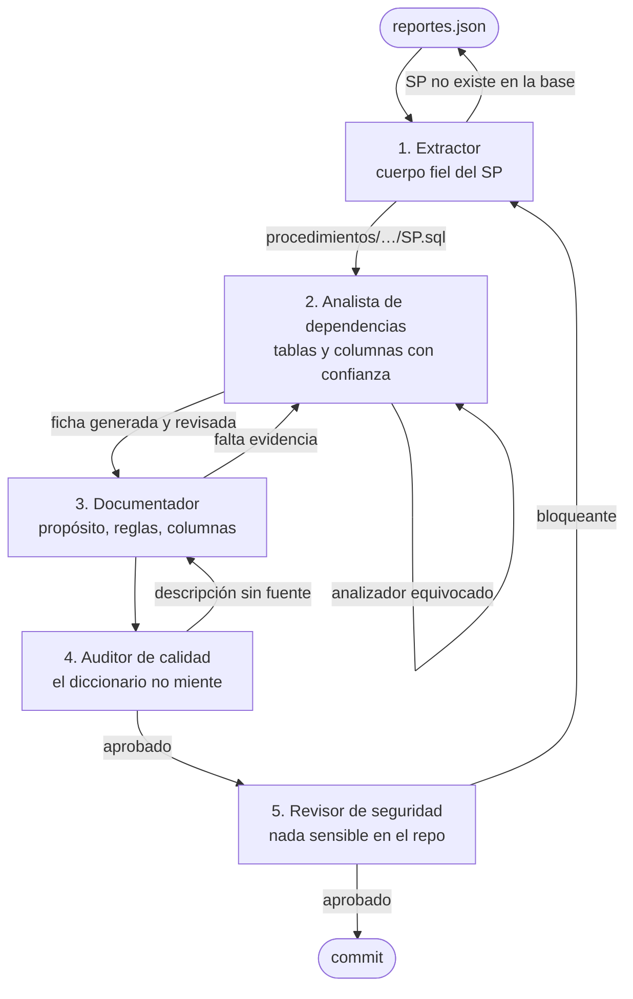

# Pipeline de agentes — DICCIONARIO

Cinco agentes secuenciales llevan un SP de ⏳ pendiente a una ficha validada y documentada. Cada uno
recibe un artefacto concreto y entrega otro: son compuertas con criterio de rechazo, no roles decorativos.



## Los cinco agentes

| # | Agente | Entrega | Rechaza cuando… |
|---|---|---|---|
| **1** | [Extractor de procedimientos](./01-extractor-procedimientos.md) | cuerpo en `procedimientos/` | el texto no es el CREATE completo o es de otro SP |
| **2** | [Analista de dependencias](./02-analista-dependencias.md) | ficha con tablas y columnas revisadas | hay columnas sin resolver que no explicó, o el analizador se equivocó sin caso de prueba |
| **3** | [Documentador del diccionario](./03-documentador-diccionario.md) | prosa de fichas de SP y tablas | una descripción no tiene fuente |
| **4** | [Auditor de calidad del dato](./04-auditor-calidad-dato.md) | visto bueno | `npm run verificar` falla, o la prosa contradice el bloque generado |
| **5** | [Revisor de seguridad y acceso](./05-revisor-seguridad.md) | dictamen | aparece un servidor, credencial, dato personal o SQL que escribe |

## Los dos transversales

| Agente | Cuándo | Rechaza cuando… |
|---|---|---|
| [Curador de gobernanza](./06-curador-gobernanza.md) | periódicamente, o cuando `verificar` falla por algo ajeno | se edita un generado o se baja una regla para destrabar |
| [Trazador del front](./07-trazador-front.md) | cuando cambia MIS-angular-front, o para priorizar | se afirma consumo sin la foto actualizada |

## Cómo se usan

Cada archivo trae frontmatter (`name`, `description`, `tools`) y una sección **Prompt de sistema**:

1. **Como subagente de Claude Code**: ya están copiados en `.claude/agents/` (`npm run generar` los sincroniza).
   Invocar por su `name`, p. ej. *"usá el agente analista-dependencias con GSREVA01"*.
2. **Como prompt directo**: pegar el bloque *Prompt de sistema* en cualquier asistente.
3. **Como checklist humano**: el cuerpo es la guía de revisión.

Las skills de `governance/skills/` son el "cómo"; los agentes, el "quién y cuándo".

## Regla común

**Cuando el documento y la fuente discrepan, gana la fuente**, y el agente que lo detecta corrige el
documento o registra el hallazgo. Comandos que todo agente puede correr:

```bash
npm run generar
npm run verificar
npm run hallazgos
npm test
```
